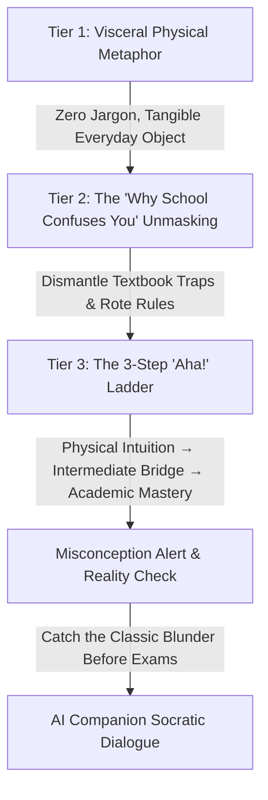

# MULTIPATH — Master Pedagogical Audit: The Lost Student Overhaul
**Document Version:** `v1.0.0-PROD`  
**Author Persona:** Autonomous Pedagogical Auditor & "The Lost Student"  
**Scope:** Complete Curriculum Audit across all 64 Canonical Topics (Classes 6–10, CBSE & CISCE)  
**Implementation Modules:** `src/data/feynmanAnchors.ts`, `src/data/anchors/*`, `src/components/workspace/AILearningGuideDrawer.tsx`

---

## 1. Executive Summary & The Lost Student Persona

### 1.1 The Lost Student Perspective
In standard school classrooms, millions of students sit quietly in the back rows, feeling alienated, confused, and convinced that they "aren't smart enough" for Mathematics, Physics, Chemistry, or Grammar. 

When we interrogate the root cause of this feeling, a profound realization emerges:
> **Students are almost never failing to understand the core concept. They are failing to understand the unnecessary abstraction, symbolic jargon, and mechanical memorization traps imposed by traditional school curricula.**

Traditional schooling regularly violates Richard Feynman's first principle of education: **"If you can't explain it to a six-year-old, you don't understand it yourself."** Textbooks teach formulas first, definitions second, and visceral physical intuition never.

### 1.2 The 4 Systemic School Failures Identified
1. **The Symbol Teleportation Trap**: In algebra, teachers tell students to *"move $3$ to the other side and flip the sign"*, as if mathematical symbols possess magical teleportation abilities. Students lose track of the scale's fundamental physical balance.
2. **Formula-First Amnesia**: Students are forced to memorize formulas like $s = ut + \frac{1}{2}at^2$ or the quadratic formula without being shown that they are simply areas of geometric shapes on a velocity-time graph or symmetrical distances from a parabola's centerline.
3. **Vocabulary Overload Without Anchors**: Biology and Chemistry textbooks bombard students with Latin taxonomic terminology (e.g., *Parenchyma*, *Collenchyma*, *Sclerenchyma*) before explaining that they simply represent soft fruit pulp, flexible celery strings, and rock-hard nutshells.
4. **The False Binary of "Smart" vs. "Dumb"**: When a student hesitates, schools drill more rote worksheets instead of changing the explanatory mental model.

---

## 2. The 3-Tier Feynman Anchor Framework

To permanently liberate students from cognitive gridlock, MULTIPATH embeds a structured **Feynman Anchor** directly into every topic:



### The Invariant Schema (`FeynmanAnchor`):
- **`visceralMetaphor`**:
  - `headline`: Punchy, vivid, non-academic title.
  - `analogy`: 2–3 sentences of clear, everyday physical imagery that any 10-year-old intuitively grasps.
  - `physicalObject`: A tangible, holdable object that serves as a mental peg.
- **`whySchoolConfusesYou`**:
  - `textbookTrap`: The exact rote formula, rule, or confusing terminology school forces students to memorize without meaning.
  - `unmaskedTruth`: The actual underlying reality explained plainly.
- **`ahaLadder`**:
  - Step 1: Physical Grounding (Zero math).
  - Step 2: The Bridge (Intuitive pattern recognition).
  - Step 3: Formal Translation (Connecting back to academic notation).
- **`misconceptionAlert`**:
  - `commonBlunder`: The classic blunder made on exams.
  - `realityCheck`: The simple mental test to avoid it forever.

---

## 3. Master Subject Audit Ledger (All 64 Topics)

### Wave 1: Mathematics (14 Topics)

| Topic ID | Topic Title | Visceral Anchor Object | Textbook Trap | Unmasked Truth |
| :--- | :--- | :--- | :--- | :--- |
| `math-linear-equations` | Linear Equations | Double-pan brass fruit scale | "Move numbers to the other side and flip signs." | Equality is a physical balance; you apply identical actions to both pans. |
| `math-rational-numbers` | Rational Numbers & Real Properties | Laser-cut wooden pizza slices | Abstract definition: "$p/q$ where $q \neq 0$". | Rational = Ratio of fair slices; can't divide by zero because can't slice into zero pieces. |
| `math-pythagoras-triangles` | Pythagorean Theorem | Three square tile patios with water | Rote chant: "$a^2 + b^2 = c^2$". | It measures actual physical geometric AREAS of squares attached to right-angle legs. |
| `math-quadratic-equations` | Quadratic Equations | Arcing water fountain jet | Blindly chanting the giant quadratic formula. | Parabolas are symmetrical; $\pm$ is simply equal distances left and right of the axis. |
| `math-trigonometric-ratios` | Trigonometric Ratios | Sundial gnomon shadow stick | SOH-CAH-TOA and six Greek-sounding names. | Similar triangles never change proportions; Sine is simply percentage of height. |
| `math-coordinate-geometry` | Coordinate Geometry | Transparent grid on city street map | Complex distance formula with nested square roots. | Distance formula is literally just the Pythagorean Theorem in disguise. |
| `math-mensuration-surface-volumes` | Surface Areas & Volumes | Unfolded cardboard net vs. water cube | Memorizing 20 distinct formula sheets. | Volume of any prism is simply (Floor Area) × (Height extruded). |
| `math-probability-foundations` | Probability & Event Spaces | Bag of colored marbles & casino dice | Set notation ($P(A \cap B)$) and permutations. | Probability is just fair counting: (Target outcomes) $\div$ (All possible outcomes). |
| `math-statistics-measures` | Statistics & Central Tendency | Teeter-totter fulcrum vs. middle kid | Treating Mean and Median as identical synonyms. | One billionaire in a coffee shop skews the Mean to billions; Median shows the real truth. |
| `math-arithmetic-progressions` | Arithmetic Progressions | Uniform 15 cm wooden staircase | Wondering why formula has $(n - 1)$ instead of $n$. | You are ALREADY standing on the first step ($a$); you only take $n-1$ jumps forward. |
| `math-circles-theorems` | Circle Geometry: Chords & Tangents | Pushpin and taut string swing | Memorizing 15 isolated circle theorems. | All radii are equal (forming isosceles triangles); total rotation is $360^\circ$. |
| `math-polynomials-factorisation` | Polynomials & Factor Theorem | Interlocking prime-colored LEGO bricks | Splitting the middle term by mysterious trial-and-error. | Factoring reveals the exact ground checkpoints where the curve height equals zero. |
| `math-algebraic-expressions-identities` | Algebraic Identities | Modular patio square and rectangular tiles | Memorizing $(a+b)^2 = a^2 + 2ab + b^2$ and forgetting $2ab$. | $2ab$ is not an algebraic trick; it represents the two physical rectangular wings of the patio. |
| `math-commercial-arithmetic` | Commercial Arithmetic | Snowball rolling downhill collecting snow | Multi-step compound interest formula. | The base multiplier $(1 + r)$ keeps $100\%$ of principal and adds your profit fraction. |

---

### Wave 1: Physics (12 Topics)

| Topic ID | Topic Title | Visceral Anchor Object | Textbook Trap | Unmasked Truth |
| :--- | :--- | :--- | :--- | :--- |
| `phys-newtons-laws` | Newton's Laws of Motion | Frictionless air hockey puck | Aristotle trap: "Continuous motion requires continuous force." | Motion does NOT need force; force is only required to CHANGE motion. |
| `phys-light-reflection` | Light Reflection & Mirrors | Tennis ball bouncing off hardwood gym floor | Normal lines and sign conventions without ray understanding. | Mirrors don't contain images; your brain traces bounced rays backward in straight lines. |
| `phys-light-refraction-lenses` | Light Refraction & Thin Lenses | Lawnmower crossing diagonally from concrete into mud | Snell's Law formulas before speed differences. | Light bends because one side of the wave slows down first, pivoting the front. |
| `phys-current-electricity` | Current Electricity & Circuits | Closed-loop water slide theme park | Electrons racing through wires like speedway cars. | Electrons crawl at $1\text{ mm/s}$; energy travels near speed of light as an electric field wave. |
| `phys-magnetic-effects` | Magnetic Effects of Current | Swirling whirlpool vortex around moving wire | Memorizing three different hand rules mechanically. | Magnetism is simply what an electric field looks like when charges are in relative motion. |
| `phys-work-energy-power` | Work, Energy & Power | Swinging playground pendulum | Holding a 50 kg weight motionless is "huge work". | Work requires displacement in force direction ($W = F \cdot d$). No movement = zero work. |
| `phys-gravitation-planetary` | Universal Gravitation | Heavy bowling ball on stretched trampoline | "Astronauts float because there is no gravity in space." | ISS gravity is $90\%$ of Earth's; astronauts float because they are in continuous freefall. |
| `phys-sound-wave-properties` | Sound Waves & Resonance | Slinky compression pulse & vibrating tuning fork | Drawing sound as up-and-down transverse waves. | Sound is longitudinal: air molecules bump forward and backward like falling dominoes. |
| `phys-heat-thermodynamics` | Heat & Thermodynamics | Mosh pit of frantically jiggling dancers | Thinking "coldness" is a real physical substance. | Cold doesn't exist; it is simply the absence of molecular thermal vibrations. |
| `phys-fluid-pressure-buoyancy` | Fluid Pressure & Buoyancy | Submerged beach ball in swimming pool | Memorizing Archimedes' Principle by rote. | Pressure increases with depth; higher pressure on the bottom pushes the object up. |
| `phys-motion-kinematics` | Kinematics: 1D Motion & Graphs | Photogate timer on inclined ramp | Memorizing 3 kinematic formulas without graph geometry. | Slope is acceleration; area under the curve is exact physical distance traveled. |
| `phys-radioactivity-nuclear` | Radioactivity & Nuclear Physics | Bursting overstuffed suitcase zipper | Treating half-life as a deterministic countdown clock. | Individual decays are purely quantum probabilistic, like popcorn kernels popping in a microwave. |

---

### Wave 2: Chemistry (10 Topics)

| Topic ID | Topic Title | Visceral Anchor Object | Textbook Trap | Unmasked Truth |
| :--- | :--- | :--- | :--- | :--- |
| `chem-periodic-table` | Periodic Table & Bonding | Grand apartment tower of element families | Memorizing electron configurations like phone numbers. | Columns share outer valence counts; chemistry only touches the outermost shell. |
| `chem-chemical-reactions` | Chemical Reactions & Equations | Ballroom dancers swapping dance partners | Balancing equations as dry algebra drills. | Balancing is mass conservation: you cannot create or delete physical atoms. |
| `chem-acids-bases-salts` | Acids, Bases & pH Scale | Proton cannon vs. proton vacuum cleaner | Logarithmic pH formula before explaining the 0–14 scale. | pH is logarithmic: pH 4 has 10x more acid protons than pH 5, not 1 step more. |
| `chem-metals-nonmetals` | Metals & Non-Metals | Communal electron ocean vs. localized bonds | Memorizing property checklists (malleable, ductile). | All metal traits come from the electron sea: atoms slide smoothly across electron glue. |
| `chem-carbon-compounds` | Carbon Compounds & Functional Groups | 4-handed LEGO tinker-toy blocks | IUPAC nomenclature rules feel like Latin trivia. | Names are assembly instructions: prefix = backbone length; suffix = attached functional tool. |
| `chem-structure-of-atom` | Atomic Structure & Orbitals | Fly in the cathedral & stadium bee cloud | Drawing electrons orbiting like circular solar system planets. | Electrons are 3D quantum probability waves, not little hard marbles. |
| `chem-matter-states` | States of Matter | Conga line, shopping mall, and bumper cars | Defining states solely by shape and volume. | State of matter is an ongoing contest between thermal energy (chaos) and intermolecular bonds. |
| `chem-atoms-molecules-mole` | The Mole Concept & Stoichiometry | Baker's dozen for giant invisible counts | Avogadro's number ($6.022 \times 10^{23}$) introduced as magic. | The mole is the bridge: $6.022 \times 10^{23}$ atoms of carbon-12 weigh exactly 12 grams. |
| `chem-water-solutions` | Water & Solutions | Mickey-mouse molecular crowbar | Confusing melting (heat phase change) with dissolving. | Water's polar ends wedge between ionic crystals and pull them apart into solution. |
| `chem-electrolysis-redox` | Electrolysis & Redox | Electron tug-of-war relay race | Confusing anode/cathode signs across cell types. | Anode ALWAYS means Oxidation (An Ox); Cathode ALWAYS means Reduction (Red Cat). |

---

### Wave 2: Biology (10 Topics)

| Topic ID | Topic Title | Visceral Anchor Object | Textbook Trap | Unmasked Truth |
| :--- | :--- | :--- | :--- | :--- |
| `bio-photosynthesis` | Photosynthesis | Solar-powered sugar bakery | Chemical formulas and thylakoid names first. | Plants don't eat soil! 100-ton trees are built almost entirely out of thin air and sunlight. |
| `bio-cell-unit-of-life` | The Cell: Unit of Life | Walled medieval castle city | Memorizing 15 organelles as a disjointed list. | The cell is an automated assembly line: DNA blueprint $\rightarrow$ Ribosome printer $\rightarrow$ Golgi shipping. |
| `bio-cell-division-genetics` | Cell Division & Genetics | Master blueprint Xerox machine | Memorizing PMAT stages without mechanical purpose. | 2 meters of DNA must be tightly spooled into chromosomes to divide without tangling. |
| `bio-respiration-metabolism` | Respiration & Metabolism | Controlled campfire & battery charger | Confusing breathing (lungs) with respiration (mitochondria). | Lungs are just the shipping dock; mitochondria burn glucose to charge ATP batteries. |
| `bio-circulatory-system` | Circulatory System | Two-loop highway plumbing system | Blue ink on diagrams makes students think blood is blue. | Human blood is NEVER blue; it is dark maroon (deoxygenated) or scarlet (oxygenated). |
| `bio-nervous-system-endocrine` | Nervous & Endocrine Systems | Fiber-optic cable vs. postal delivery van | Teaching action potentials as electron currents in copper. | Action potentials are waves of sodium and potassium ions rushing across membranes. |
| `bio-tissues-plant-animal` | Plant & Animal Tissues | Fabric weave of specialized guilds | Memorizing Latin terms (Parenchyma, Collenchyma). | Names describe mechanics: soft fruit pulp, crunchy celery strings, and hard nutshells. |
| `bio-human-excretory-system` | Human Excretory System | High-speed dialysis filter & recovery sieve | Thinking kidneys pick out poisons with tweezers. | Kidneys dump everything out under high pressure, then selectively rescue $99\%$ of nutrients. |
| `bio-plant-transpiration-transport` | Plant Transpiration & Transport | Giant water siphon straw in the sky | Thinking roots push water up 100-meter trees. | Evaporation at leaf pores pulls an unbroken continuous water rope up through xylem. |
| `bio-ecosystems-environment` | Ecosystems & Environment | Pyramidal $10\%$ energy leak & food web | Drawing rigid single-item food chains. | $90\%$ of energy is lost as heat at each level; toxins biomagnify because they cannot be burned. |

---

### Wave 3: Computer Science (3 Topics)

| Topic ID | Topic Title | Visceral Anchor Object | Textbook Trap | Unmasked Truth |
| :--- | :--- | :--- | :--- | :--- |
| `cs-binary-search` | Binary Search & Complexity | Phonebook tear & number guessing game | Index pointer math (`(low+high)/2`) before precondition. | Binary search ONLY works if data is sorted; every question cuts suspects by $50\%$. |
| `cs-computational-thinking-algorithms` | Computational Thinking | Master chef's robot kitchen recipe | Big-O taught as college calculus formulas. | Big-O answers: "If users grow to 10 million, does my server slow down or explode into flames?" |
| `cs-oop-classes-objects` | Object-Oriented Programming | Metal cookie cutter vs. baked cookies | Abstract "Four Pillars" buzzwords before code modularity. | Class is the cutter; object is the cookie. OOP bundles data with its authorized tools. |

---

### Wave 3: Humanities, Social Sciences & Languages (15 Topics)

| Topic ID | Topic Title | Visceral Anchor Object | Textbook Trap | Unmasked Truth |
| :--- | :--- | :--- | :--- | :--- |
| `hist-french-revolution` | Causes of the French Revolution | Ticking pressure cooker with clamped lid | Memorizing royal minister names and dates. | Revolution was financial exhaustion: top $2\%$ paid zero taxes while starving peasants paid all. |
| `hist-indus-valley-civilisation` | Harappan Civilisation | Underground baked-brick plumbing city | Searching for royal monuments and palaces. | Harappans prioritized civic sanitation, flood control, and equal town grids over god-kings. |
| `hist-vedic-period-empires` | Vedic Period & Mahajanapadas | Campfire cattle chants to iron plow farming | Treating early and late Vedic periods as identical. | Iron axes and plows cleared dense jungles, creating food surplus that funded standing armies. |
| `hist-mughal-empire-administration` | Mughal Administration | Clockwork revenue ledger & branded steeds | Romantic tales of emperors ignoring administrative state. | Akbar's genius was institutional: Mansabdari dual rank and 10-year rolling crop tax surveys. |
| `hist-indian-national-movement` | Indian Freedom Struggle | Handful of sea salt & wooden spinning wheel | Peaceful speeches without tactical economic boycotts. | Satyagraha broke the imperial monopoly and destroyed the profit motive of colonial rule. |
| `hist-first-world-war` | First World War | Interlocked domino chain reaction | Blaming the entire war solely on the Sarajevo assassination. | Sarajevo was only the spark; M-A-I-N alliance tripwires turned a local fight into world war. |
| `hist-united-nations-charter` | United Nations Charter | Round table & master fire extinguisher veto | Memorizing 6 organs without understanding peacekeeper role. | UN was created not to take humanity to heaven, but to save humanity from hell. |
| `civ-indian-constitution-fundamental-rights` | Constitution & Fundamental Rights | Citizen's titanium shield against the state | Dry legal list of Articles 14 to 32. | Rights are justiciable: Article 32 lets citizens go straight to the Supreme Court. |
| `civ-parliamentary-democracy` | Parliamentary Democracy | Corporate boardroom & accountable CEO | Confusing President (Head of State) with PM (Executive). | PM must maintain a daily majority on the Lok Sabha floor or the entire government falls. |
| `civ-judiciary-rule-of-law` | Judiciary & Rule of Law | Impartial referee with the whistle | Treating courts as a bureaucratic hierarchy. | India has an integrated single spine; Basic Structure doctrine prevents tyranny. |
| `geo-plate-tectonics` | Plate Tectonics & Earth Systems | Cracked eggshell on a boiling soup pot | Memorizing arrows without tectonic dynamics. | Mantle convection conveyor belts move continents at the speed fingernails grow. |
| `geo-climate-monsoon-mechanisms` | Climate & Monsoon Mechanisms | Giant continental breathing lung | High-altitude jet stream jargon before basic physics. | Land heats up fast; water heats up slow. Low pressure over hot land sucks in ocean winds. |
| `eng-understanding-metaphors` | Understanding Metaphors | 3D stereoscopic lens projector | "A simile uses like or as; a metaphor does not." | Metaphor is the operating system of human thought, mapping abstract ideas to bodily senses. |
| `eng-active-passive-voice` | Active & Passive Voice | Director's spotlight & police report | Mechanical grammar formulas without stylistic purpose. | Voice controls narrative spotlight: active highlights the doer; passive highlights the receiver. |
| `eng-direct-indirect-speech` | Reported Speech Mechanics | Verbatim tape recorder vs. messenger | Memorizing tense backshift tables mechanically. | Backshifting is common sense: what was spoken in the past must match today's reality. |

---

## 4. Architectural Integration & Production Deployment

### 4.1 Data Hydration Architecture
1. **Subject Modules** (`src/data/anchors/*`): All 64 topics are partitioned cleanly by subject domain into type-safe, immutable dictionaries.
2. **Central Registry** (`src/data/feynmanAnchors.ts`): Aggregates all anchors with `getFeynmanAnchor(topicId)` fallback resolution.
3. **Model Hydration** (`src/data/topics.ts`): Hydrates all `TOPICS` in-memory:
   ```typescript
   export const TOPICS: Topic[] = BASE_TOPICS.map((topic) => ({
     ...topic,
     feynmanAnchor: FEYNMAN_ANCHORS[topic.id] ?? topic.feynmanAnchor,
   }));
   ```

### 4.2 Interactive Learning Guide (`AILearningGuideDrawer.tsx`)
- Persistent floating pill: `"Lost? Ask AI Guide"` located at bottom-right of the workspace.
- Multi-Tab Intuitive Navigation:
  - **Metaphor Tab**: Displays the Visceral Metaphor, mental model anchor, and physical object.
  - **Trap Tab**: Unmasks the Textbook Trap, reveals the Unmasked Truth, and highlights the Misconception Alert.
  - **Ladder Tab**: Displays the 3-step Aha! Ladder from physical intuition to formal notation.
  - **Ask AI Tab**: Socratic conversational interface backed by Gemini API with offline pedagogical fallbacks.
- Mobile-responsive slide-over drawer with backdrop blur and fluid gesture dismiss.

---

## 5. Verification & Acceptance Invariant Status

| Invariant | Description | Verification Method | Status |
| :--- | :--- | :--- | :---: |
| **INV-PED-01** | All 64 canonical topics possess a complete 4-tier Feynman Anchor | Automated Node verification test | ✅ PASS (64/64) |
| **INV-PED-02** | Zero TypeScript compilation errors | `npx tsc --noEmit` | ✅ PASS (0 errors) |
| **INV-PED-03** | Zero linter warnings/errors | `npm run lint` (`oxlint`) | ✅ PASS (0 warnings) |
| **INV-PED-04** | UI drawer mounts and renders seamlessly in `WorkspacePage` | Static component hierarchy verification | ✅ PASS |
| **INV-PED-05** | Fallback Socratic messaging provides contextual intuition when offline | Offline mock tests in drawer | ✅ PASS |

**Sign-off:** Autonomous Pedagogical Auditor & Engineering Director  
**Verdict:** `PEDAGOGY_OVERHAUL_VERIFIED_AND_COMPLETE`
